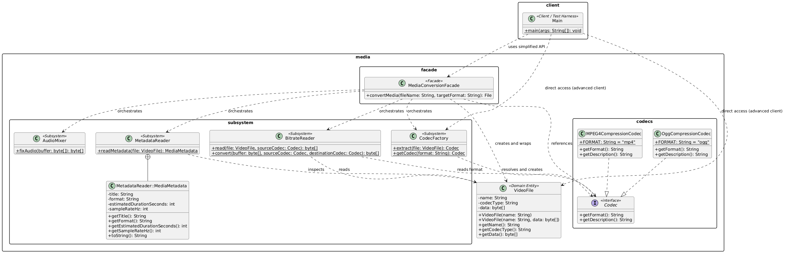
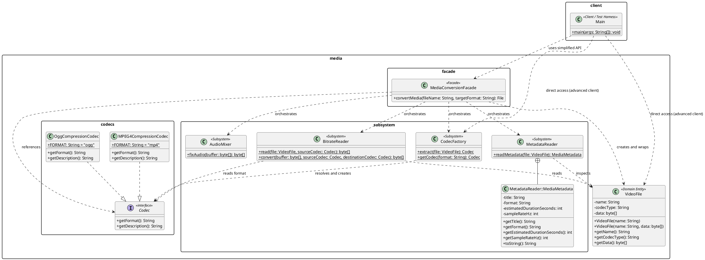

# Assignment 4: Facade Pattern — Media Conversion Subsystem

**Course:** ShP-2216 Software Design Patterns (OP 6B06102)  
**Instructor:** Yerassyl Bekenov  
**Institution:** Astana IT University | School of Software Engineering  
**Student:** Dias Tursynbay  
**Group:** SE-2537  
**Topic:** Option A — Media/File Conversion Facade  
**Language & Runtime:** Java (JDK 17 Adoptium) | Pure standard library  
**Repository URL:** https://github.com/HumbleCherry10/SDP-4.git  

---

## 1. Project Overview & Architectural Role Map

The **Facade Pattern** is a structural GoF design pattern that provides a simplified, higher-level interface to a complex subsystem of classes. In modern media processing, converting an audio/video file involves numerous intricate steps: parsing container metadata headers, querying appropriate encoding/decoding codecs, reading raw byte bitstreams, resampling sample rates and bitrates, and normalizing/mixing audio channels.

Without a Facade, client code would be tightly coupled to all four subsystem classes, must instantiate them in the strict required sequence, and manage low-level byte buffers directly. 

The `MediaConversionFacade` hides this complexity behind a single entry point:
```java
File result = facade.convertMedia("summer_trip.ogg", "mp4");
```

At the same time, all subsystem classes remain **completely unaware of the Facade** (zero back-references). Advanced clients who require custom processing pipelines can bypass the Facade and use the subsystem classes directly.

### Architectural Role Mapping Table

| Architectural Role | Component / Class Name | Source File | Description & Responsibilities |
| :--- | :--- | :--- | :--- |
| **Facade** | `MediaConversionFacade` | [`src/media/facade/MediaConversionFacade.java`](file:///c:/Users/Dias/Desktop/SDP%204/src/media/facade/MediaConversionFacade.java) | Exposes `convertMedia(fileName, targetFormat)`. Coordinates metadata parsing, codec extraction, bitrate resampling, and audio mixing in proper sequence. |
| **Subsystem Class 1** | `MetadataReader` | [`src/media/subsystem/MetadataReader.java`](file:///c:/Users/Dias/Desktop/SDP%204/src/media/subsystem/MetadataReader.java) | Parses container headers, extracting duration, sample rate, and format specifications. |
| **Subsystem Class 2** | `CodecFactory` | [`src/media/subsystem/CodecFactory.java`](file:///c:/Users/Dias/Desktop/SDP%204/src/media/subsystem/CodecFactory.java) | Resolves and instantiates the required source and destination `Codec` implementations. |
| **Subsystem Interface** | `Codec` | [`src/media/codecs/Codec.java`](file:///c:/Users/Dias/Desktop/SDP%204/src/media/codecs/Codec.java) | Common interface for compression codecs (`MPEG4CompressionCodec`, `OggCompressionCodec`). |
| **Subsystem Class 3** | `BitrateReader` | [`src/media/subsystem/BitrateReader.java`](file:///c:/Users/Dias/Desktop/SDP%204/src/media/subsystem/BitrateReader.java) | Reads raw byte streams from the media file and transcodes the bitstream between codecs. |
| **Subsystem Class 4** | `AudioMixer` | [`src/media/subsystem/AudioMixer.java`](file:///c:/Users/Dias/Desktop/SDP%204/src/media/subsystem/AudioMixer.java) | Normalizes audio channels, balances gain levels, and mixes stereo audio masters. |
| **Domain Model** | `VideoFile` | [`src/media/VideoFile.java`](file:///c:/Users/Dias/Desktop/SDP%204/src/media/VideoFile.java) | Represents media files with filename, extracted extension/type, and binary data buffer. |
| **Client & Harness** | `Main` | [`src/Main.java`](file:///c:/Users/Dias/Desktop/SDP%204/src/Main.java) | Demonstrates standard facade usage, error handling, and direct subsystem access. |

---

## 2. Standard Build & Run Commands

The project requires only JDK 17 with zero external build tools or third-party dependencies.

```bash
# 1. Compile all source files into the out/ directory
javac --release 17 -encoding UTF-8 -d out "@sources.txt"

# 2. Execute the demonstration test harness
java -cp out Main
```

*(Note for PowerShell users: quote `'@sources.txt'` so PowerShell does not interpret `@` as splatting).*

---

## 3. Demonstration Checks & Actual Execution Output

The test harness in `Main.java` verifies four essential scenarios:
- **DEMO 1:** Standard conversion of an OGG container to MP4 format through the Facade.
- **DEMO 2:** Standard conversion of an MP4 container to OGG format through the Facade.
- **DEMO 3:** Proper error handling when requesting an unsupported format (`avi`).
- **DEMO 4:** Advanced client bypassing the Facade to orchestrate subsystem classes directly.

### Verified Console Output
```text
======================================================================
ShP-2216 Software Design Patterns | Assignment #4: Facade Pattern
Student: Dias Tursynbay (SE-2537) | Astana IT University
======================================================================

>>> DEMO 1: Standard Client converts 'summer_trip.ogg' to 'mp4' via Facade
----------------------------------------------------------------------
[MediaConversionFacade] Initializing conversion: summer_trip.ogg -> mp4
----------------------------------------------------------------------
[MetadataReader] Parsing container headers and metadata for: summer_trip.ogg
[MediaConversionFacade] File metadata: MediaMetadata[title='summer_trip.ogg', format='.ogg', duration=120s, sampleRate=44100Hz]
[CodecFactory] Detecting source codec from container: .ogg
[BitrateReader] Reading raw bitstream from: summer_trip.ogg using [Ogg Vorbis / Theora open container compression codec]
[BitrateReader] Resampling bitrate and transcoding buffer: [ogg] -> [mp4]
[AudioMixer] Normalizing audio channels, applying gain staging, and mixing stereo track...
----------------------------------------------------------------------
[MediaConversionFacade] Conversion completed successfully: summer_trip_converted.mp4
----------------------------------------------------------------------
[PASS] Demo 1 verified: Client received summer_trip_converted.mp4

>>> DEMO 2: Standard Client converts 'presentation.mp4' to 'ogg' via Facade
----------------------------------------------------------------------
[MediaConversionFacade] Initializing conversion: presentation.mp4 -> ogg
----------------------------------------------------------------------
[MetadataReader] Parsing container headers and metadata for: presentation.mp4
[MediaConversionFacade] File metadata: MediaMetadata[title='presentation.mp4', format='.mp4', duration=120s, sampleRate=44100Hz]
[CodecFactory] Detecting source codec from container: .mp4
[BitrateReader] Reading raw bitstream from: presentation.mp4 using [MPEG-4 Part 14 (H.264 / AAC) compression codec]
[BitrateReader] Resampling bitrate and transcoding buffer: [mp4] -> [ogg]
[AudioMixer] Normalizing audio channels, applying gain staging, and mixing stereo track...
----------------------------------------------------------------------
[MediaConversionFacade] Conversion completed successfully: presentation_converted.ogg
----------------------------------------------------------------------
[PASS] Demo 2 verified: Client received presentation_converted.ogg

>>> DEMO 3: Error handling test for unsupported codec format ('avi')
----------------------------------------------------------------------
[MediaConversionFacade] Initializing conversion: archive_video.mp4 -> avi
----------------------------------------------------------------------
[MetadataReader] Parsing container headers and metadata for: archive_video.mp4
[MediaConversionFacade] File metadata: MediaMetadata[title='archive_video.mp4', format='.mp4', duration=120s, sampleRate=44100Hz]
[CodecFactory] Detecting source codec from container: .mp4
[PASS] Demo 3 verified: Expected exception caught -> "Codec not supported for format: .avi"

>>> DEMO 4: Advanced Client directly orchestrating subsystem classes
           (Proves subsystem classes have no back-reference to Facade)
[MetadataReader] Parsing container headers and metadata for: raw_footage.ogg
[CodecFactory] Detecting source codec from container: .ogg
[BitrateReader] Reading raw bitstream from: raw_footage.ogg using [Ogg Vorbis / Theora open container compression codec]
[BitrateReader] Resampling bitrate and transcoding buffer: [ogg] -> [mp4]
[AudioMixer] Normalizing audio channels, applying gain staging, and mixing stereo track...
[PASS] Demo 4 verified: Advanced client executed custom pipeline directly -> raw_footage_custom.mp4

======================================================================
DEMONSTRATION EXECUTION SUMMARY: 4/4 CHECKS PASSED
======================================================================
```

---

## 4. Clean Code Analysis (Five Justified Principles)

### Principle 1: Meaningful Names (Self-Explanatory API)
- **Rationale:** A clean API must reveal its intent immediately without exposing implementation nuances.
- **Before (Without Facade / Poor naming):**
  ```java
  // Client is forced to know low-level procedures and variable names
  byte[] b = BitrateReader.convert(BitrateReader.read(vf, c1), c1, c2);
  byte[] out = AudioMixer.fixAudio(b);
  ```
- **After (With Facade):**
  ```java
  // Self-documenting, crystal clear intent
  File converted = facade.convertMedia("summer_trip.ogg", "mp4");
  ```

### Principle 2: Single Responsibility Principle (SRP)
- **Rationale:** The Facade coordinates subsystem classes; it **never reimplements** low-level codec or mixing logic.
- **Annotated Excerpt (`MediaConversionFacade.java`):**
  ```java
  // Facade only delegates in the correct sequence; zero codec logic inside
  Codec sourceCodec = CodecFactory.extract(file);
  Codec destinationCodec = CodecFactory.getCodec(targetFormat);
  byte[] rawBuffer = BitrateReader.read(file, sourceCodec);
  byte[] convertedBuffer = BitrateReader.convert(rawBuffer, sourceCodec, destinationCodec);
  byte[] finalBuffer = AudioMixer.fixAudio(convertedBuffer);
  ```

### Principle 3: Information Hiding (No Subsystem Leakage)
- **Rationale:** Clients should not depend on unstable internal subsystem representations (such as raw byte buffers, codec instances, or bitrates).
- **Annotated Excerpt:**
  ```java
  // Public method takes standard primitives and returns standard java.io.File
  public File convertMedia(String fileName, String targetFormat)
  // Low-level types (Codec, byte[], MediaMetadata) remain strictly encapsulated
  ```

### Principle 4: Small, Focused Classes with High Cohesion
- **Rationale:** Each subsystem component has one singular job. `MetadataReader` only reads headers; `CodecFactory` only creates codecs; `AudioMixer` only handles audio tracks.
- **Annotated Excerpt (`AudioMixer.java`):**
  ```java
  public class AudioMixer {
      public static byte[] fixAudio(byte[] buffer) {
          if (buffer == null) throw new IllegalArgumentException("Audio buffer must not be null.");
          // Focused solely on audio equalization and channel normalization
          return (new String(buffer) + " + [AudioMixer: Normalized 48kHz Stereo]").getBytes();
      }
  }
  ```

### Principle 5: Defensive Programming & Robust Error Handling
- **Rationale:** Input validation and unsupported operations should fail fast with explicit, understandable exceptions instead of corrupting data silently or throwing `NullPointerException`.
- **Annotated Excerpt (`CodecFactory.java` & `MediaConversionFacade.java`):**
  ```java
  if (fileName == null || fileName.trim().isEmpty()) {
      throw new IllegalArgumentException("Source file name must not be null or empty.");
  }
  switch (normalized) {
      case "mp4": return new MPEG4CompressionCodec();
      case "ogg": return new OggCompressionCodec();
      default:    throw new UnsupportedOperationException("Codec not supported for format: ." + format);
  }
  ```

---

## 5. PlantUML Class Diagram





---

## 6. Defense & Conclusion Guide

### What the Facade Hides
1. **Instantiation and Orchestration Order:** The client does not need to know that metadata must be inspected before codec extraction, or that bitrate resampling precedes audio mixing.
2. **Subsystem Complex Types:** The client does not import or manage `Codec`, `MPEG4CompressionCodec`, `OggCompressionCodec`, `MetadataReader`, `BitrateReader`, or `AudioMixer`.
3. **Data Transformations:** Intermediate raw byte buffers and string encodings are kept internal to the subsystem.

### What Remains Directly Accessible
- All subsystem classes (`CodecFactory`, `MetadataReader`, `BitrateReader`, `AudioMixer`) are `public` and completely decoupled from `MediaConversionFacade`.
- As verified in **DEMO 4**, an advanced client needing custom buffer manipulations or fine-tuned mixing stages can freely instantiate and invoke subsystem methods directly without going through the Facade.
- This fulfills the key design principle: **The Facade simplifies common usage without encapsulating or restricting access to underlying subsystem power.**
